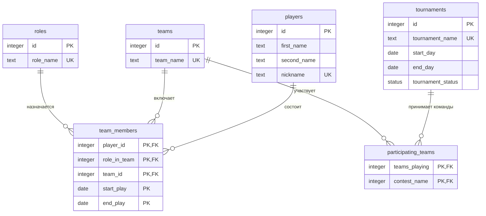

<!--
  Это шаблон. После создания своего репозитория:
  1. Назовите репозиторий db-<фамилия>-<тема>, например db-ivanova-cinema.
  2. Заполните разделы ниже под свою тему и удалите этот комментарий.
-->

# Киберспортивная лига

База хранит данные о киберспортивных командах, их участниках, турнирах и матчах

| | |
| --- | --- |
| Главная таблица | Players |
| Связь N:M | Players и Teams через `data` |
| Бизнес-правило | Игрок одновременно только в одной команде |
| СУБД | PostgreSQL 17 в Docker |

## Задания курса

Правила курса, установка и порядок сдачи: [docs/README.md](docs/README.md).

| Лаба | Задание |
| --- | --- |
| 1. Модель данных и схема | [docs/lab-1.md](docs/lab-1.md) |
| 2. Запросы | [docs/lab-2.md](docs/lab-2.md) |
| 3. Логика в базе | [docs/lab-3.md](docs/lab-3.md) |
| 4. Транзакции и доступ | [docs/lab-4.md](docs/lab-4.md) |
| 5. Производительность | [docs/lab-5.md](docs/lab-5.md) |
| Витрина к защите | [docs/showcase.md](docs/showcase.md) |

## Как запустить

```bash
cp .env.example .env          # пароли и порт
docker compose up -d          # при первом запуске выполняются скрипты из db/
dbcheck run demo/lab1.sql     # сценарий лабы 1
```

Работа с базой: `docker compose exec db psql -U postgres -d app`. Сценарии выполняются в `psql` командой `\i /demo/lab1.sql`.

После изменения скриптов в `db/` базу нужно пересоздать: `docker compose down -v && docker compose up -d`.

## ER-диаграмма

<!-- Замените пример своими таблицами: 5+ таблиц, связь N:M через связующую таблицу. -->


Схема базы данных была доведена до 3НФ и следует ее требованиям: данные о командах, игроках, ролях и турнирах хранятся в отдельных таблицах; связующие таблицы содержат внешние ключи и атрибуты, относящиеся к соответствующим связям. Это позволяет избежать избыточного дублирования данных и аномалий при вставке, обновлении и удалении.
## Ограничения

| Ограничение | Таблица и колонки                     | Зачем                                                   |
|-------------|---------------------------------------|---------------------------------------------------------|
| `NOT NULL`  | roles: `role_name`    | Роль должна иметь название           |
|             | teams: `team_name`    | Команда должна иметь название           |
|             | players: `first_name, second_name, nickname`    | Игрок должен иметь непустые имя, фамилию, никнейм           |
|             | team_members: `player_id, role_in_team, team_id, start_play, end_play`    | База данных должна ссылаться на игроков по `player_id`, иначе она не сможет получить о нем данные           |
|             | tournaments: `tournament_name, start_day, end_day, status`    | Турнир должен иметь название, даты начала и окончания и статус           |
|             | participating_teams: `teams_playing, contest_name`    | База данных должна ссылаться на команды и турниры, иначе она не сможет получить о них данные           |
| `UNIQUE`    | roles - `role_name`                   | Роли не могут дублироваться                             |
|             | teams - `team_name`                   | Все команды должны быть разные                          |
|             | players - `nickname`                  | Игрок не должен содержаться в базе больше 1 раза        |
|             | tournaments - `tournament_name`       | Турниры не должны дублироваться                         |
| `CHECK`     | team_members: `start_play < end_play` | Старт карьеры не может произойти позже ухода из команды |
|             | tournaments: `start_day < end_day`    | Турнир не может начаться позже даты окончания           |
| `FOREIGN KEY` | team_members: `player_id`    | Ссылается на `id` из таблицы `players`           |
|               | team_members: `role_in_team`    | Ссылается на `id` из таблицы `roles`           |
|               | team_members: `team_id`    | Ссылается на `id` из таблицы `teams`           |
|               | participating_teams: `teams_playing`    | Ссылается на `id` из таблицы `teams`           |
|               | participating_teams: `contest_name`    | Ссылается на `id` из таблицы `tournaments`           |


## Что сделано по лабам

| Лаба | Что сделано | Сценарий |
| --- | --- | --- |
| 1 | ... | `demo/lab1.sql` |
| 2 | ... | `demo/lab2.sql` |
| 3 | ... | `demo/lab3.sql` |
| 4 | ... | `demo/lab4.sql`, `demo/race.sql`, `demo/race_fixed.sql` |
| 5 | ... | `demo/lab5.sql` |

<!--
  Разделы, которые добавляются по ходу курса:
  лаба 1 ★: «Нормализация», «Типы данных»; ★★: «Что происходит при удалении»;
  лаба 4: «Гонка»;
  лаба 5: «Производительность» (таблица до / после, когда индекс не помогает, размеры).
-->
